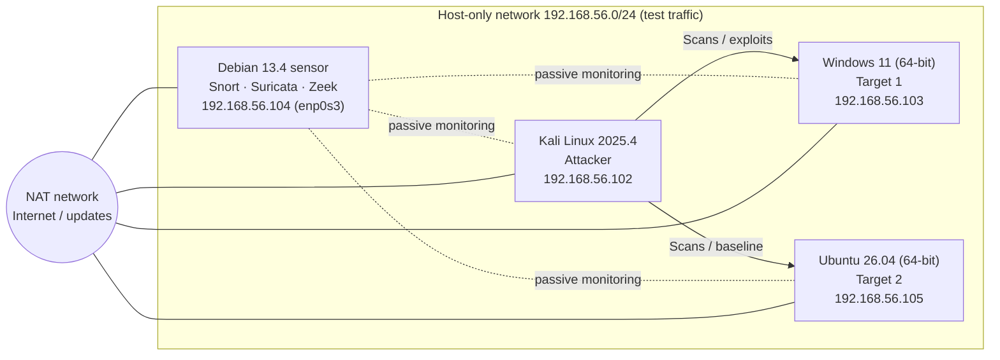

<div align="center">

# Snort vs. Suricata vs. Zeek

**Comparative evaluation of the detection performance of open-source IDS against reproducible exploit attacks in a virtualised lab environment**


[](https://github.com/if23b152/Bachelorarbeit-ids/actions/workflows/ci.yml)

</div>

---

This repository accompanies a bachelor thesis that tested the three best-known open-source intrusion detection systems – **Snort**, **Suricata** and **Zeek** – against each other under identical conditions. It contains the complete lab setup, the configurations and rules used, helper scripts, the evaluation scheme and the results, prepared so that third parties can follow and repeat the experiments.

> **In short:** all three systems saw the attacks – but in completely different ways.
> **Suricata** produces the richest alerts, **Snort** the most compact and resource-friendly alerting, **Zeek** the most structured, analysis-oriented view through logs. There is no single "best" IDS – the right choice depends on the use case.

*The thesis itself was written in German; this repository documents its setup and results in English.*

## Contents

- [Research question](#research-question)
- [Lab environment](#lab-environment)
- [Methodology](#methodology)
- [Results](#results)
  - [TCP SYN scan](#1-tcp-syn-scan-reconnaissance)
  - [Windows – exploit-oriented SMB scenario](#2-windows--exploit-oriented-smb-scenario)
  - [Resource usage](#3-resource-usage)
  - [Evaluation matrix](#4-evaluation-matrix-qualitative-scale-15)
- [Conclusion and recommendation](#conclusion-and-recommendation)
- [Reproducing the experiments](#reproducing-the-experiments)
- [Repository structure](#repository-structure)
- [Limitations and outlook](#limitations-and-outlook)

## Research question

> How do the open-source intrusion detection systems Snort, Suricata and Zeek differ in their detection performance for selected, reproducible network attack scenarios in a controlled lab environment?

| Sub-question | Content |
|---|---|
| **RQ1** | How do the three systems differ in detection performance for identical attack scenarios? |
| **RQ2** | Can a reliable evaluation matrix for a structured comparison be derived from the measurements? |
| **RQ3** | How do the systems differ in CPU/RAM usage and practical usability? |

## Lab environment

All systems run as VMs in **VirtualBox**. Attacker, targets and sensor are strictly separated; test traffic runs exclusively over an internal **host-only network**, while the NAT network is only used for updates and package installation.



| Role | System | Host-only IP | Tools |
|---|---|---|---|
| Attacker | Kali Linux 2025.4 | `192.168.56.102` | Metasploit, Nmap, tcpdump, TShark |
| Target 1 (focus) | Windows 11, 64-bit | `192.168.56.103` | SMB service on port 445 |
| Target 2 (baseline) | Ubuntu 26.04, 64-bit | `192.168.56.105` | – |
| Sensor | Debian 13.4, 64-bit | `192.168.56.104` | Snort 3, Suricata, Zeek 9.0.0-dev |

The three IDS run **one after another** on the same sensor VM and therefore observe identical or comparable traffic. Details: [`docs/labor-setup.md`](docs/labor-setup.md) · [`docs/network-plan.md`](docs/network-plan.md)

## Methodology

A combination of literature review and a quantitative experiment. The same [evaluation scheme](docs/detection-schema.md) is applied to every test case:

1. **Was an alert raised?** – the most important criterion
2. **Is there a suspicious log entry?** – relevant mainly for Zeek, which hardly produces classic alerts
3. **Timing** – real time, delayed, or only visible in the logs afterwards

In addition, CPU/RAM as well as installation/configuration effort, analysability, documentation and usability (scale 1–5) are assessed.

**Configuration phases:** first a configuration close to the defaults, then targeted local rules (`local.rules`) so that test scans in the host-only network are alerted in a traceable way. All configurations used are in [`configs/`](configs/).

**Tested scenarios**

| ID | Scenario | Target | Tool |
|---|---|---|---|
| B-01 | Ping / host discovery (`nmap -sn`) | Windows, Ubuntu | Nmap |
| B-02 | Service scan (`nmap -sV`) | Windows, Ubuntu | Nmap |
| S-01 | TCP SYN scan (`nmap -sS`) | Windows, Ubuntu | Nmap |
| W-01 | MS17-010 EternalBlue (probe/check) against SMB 445 | Windows | Metasploit |
| W-02 | SMB authentication via `psexec` (NTLM) against SMB 445 | Windows | Metasploit |

The goal was **not** a successful compromise, but whether and how the attack traffic is detected. Both Windows exploits failed (no session, `STATUS_ACCESS_DENIED`) – but left analysable traces on the network. See [`docs/exploit-list.md`](docs/exploit-list.md) and [`docs/testplan.md`](docs/testplan.md).

## Results

Detailed evaluation per system: [`docs/results.md`](docs/results.md) · raw tables as CSV: [`results/tables/`](results/tables/)

### 1. TCP SYN scan (reconnaissance)

| Criterion | Suricata | Snort | Zeek |
|---|---|---|---|
| Alert raised | ✅ Yes – local rule | ✅ Yes – local rule | ➖ No classic alert |
| Visibility | `fast.log` + `eve.json` | `alert_fast` in the terminal | `conn.log` (structured) |
| Alert quality | > 2000 individual events, extra background alert (DHCP) | many individual messages per target port | clear connection records, `conn_state` `REJ`/`RSTO` |
| Aggregation | 🔴 low – every packet separately | 🔴 low – every port separately | 🟢 high – tabular |

**Finding:** signature-based IDS "shout" very loudly during broad scans – detection is reliable, but without thresholding the output is barely readable. Zeek summarises the same scan as a traceable connection table.

### 2. Windows – exploit-oriented SMB scenario

| Criterion | Suricata | Snort | Zeek |
|---|---|---|---|
| Alert (W-01 EternalBlue) | ✅ local TCP rule, SMB 445 | ✅ 2 alerts, local TCP rule 445 | ➖ no alert |
| Alert (W-02 psexec/NTLM) | ✅ TCP rule **+ NTLM alerts** (negotiate, challenge, auth) | ✅ 1 alert, local TCP rule 445 | ➖ no alert |
| Suspicious log entries | `fast.log`, `eve.json` | `alert_fast` | `conn.log` (W-01), `conn.log` + **`ntlm.log`** (W-02) |
| Protocol depth | 🟢 high – NTLM phases visible | 🔴 low – TCP rule only | 🟡 medium–high |
| Alert volume | moderate | very low (1–2 per run) | none – structured logs |
| Timing | real time | real time | real time (analysed after the run) |
| Background alerts | yes (Kali hostname in DHCP request) | no | no |

**Finding:** for targeted exploit attempts the alert volume drops considerably and the results become easy to interpret. Suricata and Zeek decode the SMB/NTLM protocol and expose the phases of the failed login; Snort detects the access but is limited to the local TCP rule.

### 3. Resource usage

Observed values of the IDS process on the sensor VM (`ps`/`top` during the run):

| Scenario | Metric | Suricata | Snort | Zeek |
|---|---|---:|---:|---:|
| SYN scan | CPU | ~5.0 % | ~6.1 % | **~1.3 %** |
| SYN scan | MEM | ~11.0 % | **~0.8 %** | ~5.2 % |
| SYN scan | RSS | 557,584 KB | **43,796 KB** | 265,544 KB |
| Windows W-01 | CPU | ~15.4 % | ~6.0 % | **~1.3 %** |
| Windows W-01 | MEM | ~10.6 % | **~0.8 %** | ~5.1 % |
| Windows W-02 | CPU | double-digit | ~6.0 % | **~0.8 %** |
| Windows W-02 | MEM | ~10.6 % | **~0.8 %** | ~5.1 % |

- **Snort**: by far the lowest memory footprint (~44 MB RSS)
- **Zeek**: lowest CPU load, memory in the middle
- **Suricata**: highest memory footprint (~0.5 GB RSS) and double-digit CPU load during exploits

### 4. Evaluation matrix (qualitative, scale 1–5)

`1` = very unfavourable/laborious · `3` = acceptable · `5` = very favourable/easy

| Criterion | Suricata | Snort | Zeek | Rationale |
|---|:---:|:---:|:---:|---|
| Installation effort | **5** | 3 | 2 | Suricata via `apt` ~20 min · Snort from source ~30 min · Zeek from source > 90 min (`make` alone ~70 min) |
| Configuration effort | 3 | 3 | **4** | Suricata: default rules + simple local additions · Snort: local rule file required · Zeek: no rules needed |
| Analysability | 3 | 2 | **4** | Suricata: `fast.log` + `eve.json` · Snort: cluttered with many alerts · Zeek: structured logs |
| Documentation / community | **5** | 4 | 4 | docs.suricata.io · snort.org + large community · docs.zeek.org |
| Practical usability | **5** | 4 | 3 | Suricata ready to use immediately · Snort direct but rule-dependent · Zeek requires active log analysis |
| **Total** | **21** | **16** | **17** | |

## Conclusion and recommendation

| If you need … | use | because |
|---|---|---|
| rich, protocol-aware **alerts** and a quick start | **Suricata** | most differentiated alerting (e.g. NTLM phases), `eve.json` for SIEM, installation via package manager |
| **lightweight**, direct alerting on weak hardware | **Snort** | lowest RAM usage, alerts immediately in the terminal – but its value depends heavily on the rule base |
| **forensics** / network security monitoring, reconstructing whole sequences | **Zeek** | structured, compact logs (`conn.log`, `ntlm.log`, …) at the lowest CPU load – but no alerts without custom scripts |

The systems complement rather than replace each other: a combination of **Suricata (alerting) + Zeek (context/forensics)** covers both sides in practice.

## Reproducing the experiments

> ⚠️ Only run this in an isolated lab environment. The attacks are aimed exclusively at your own test VMs.

```bash
# 1. Clone the repo on the sensor VM and create the result folders
git clone https://github.com/if23b152/Bachelorarbeit-ids.git && cd Bachelorarbeit-ids
./scripts/setup/prepare_dirs.sh

# 2. Apply the IDS configuration (Suricata example)
sudo cp configs/suricata/local.rules /var/lib/suricata/rules/local.rules
sudo suricata -T -c /etc/suricata/suricata.yaml          # check the configuration

# 3. Start the IDS on the host-only interface (only ONE IDS at a time)
sudo suricata -c /etc/suricata/suricata.yaml -i enp0s3
#   sudo snort -c configs/snort/snort.lua -R configs/snort/local.rules -i enp0s3 -A alert_fast
#   sudo zeek -i enp0s3 configs/zeek/local.zeek     (inside the output folder, e.g. /opt/zeek-win-test1)

# 4. In parallel: measure resources and capture traffic
./scripts/evaluation/measure_resources.sh suricata 60
sudo ./scripts/capture/start_tcpdump.sh enp0s3

# 5. On Kali: run the scenario (see docs/exploit-list.md)
#   nmap -sS 192.168.56.103

# 6. Collect logs and count alerts
sudo ./scripts/capture/collect_logs.sh
./scripts/evaluation/count_alerts.sh
```

Every run is documented with [`templates/test_result_template.md`](templates/test_result_template.md).

## Repository structure

```text
Bachelorarbeit-ids/
├── configs/            IDS configurations and local rules
│   ├── snort/          snort.lua (minimal config) + local.rules
│   ├── suricata/       local.rules + notes on suricata.yaml
│   └── zeek/           local.zeek + notes on logs
├── docs/               lab setup, network plan, test plan, scenario list,
│                       evaluation scheme and detailed results
├── results/
│   ├── raw/            raw data (PCAPs/logs stay local) and screenshots
│   └── tables/         result tables as CSV
├── scripts/
│   ├── setup/          prepare the folder structure
│   ├── capture/        tcpdump capture, collect logs
│   └── evaluation/     measure resources, count alerts
├── templates/          templates for test cases and test results
└── thesis/             outline and working notes
```

## Limitations and outlook

- Detailed exploit evaluation only for the **Windows target**; Ubuntu was used for the setup and baseline.
- Few repetitions per test case; CPU/RAM are **observed values**, not standardised measurement series.
- The value of Snort/Suricata depends heavily on the rule set – local test rules are not a complete representation of real attacks.

Possible extensions: exploit scenarios against Linux, a systematic comparison of default vs. custom rules (incl. thresholding), Zeek scripts / notice framework, more repetitions, payload delivery and multi-stage attacks.
